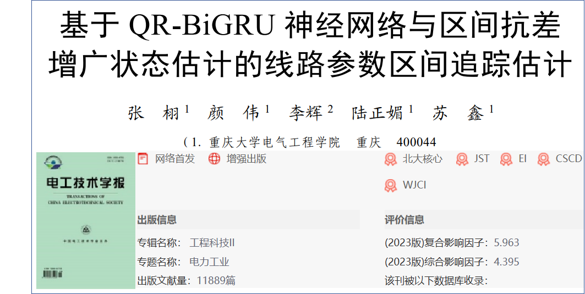
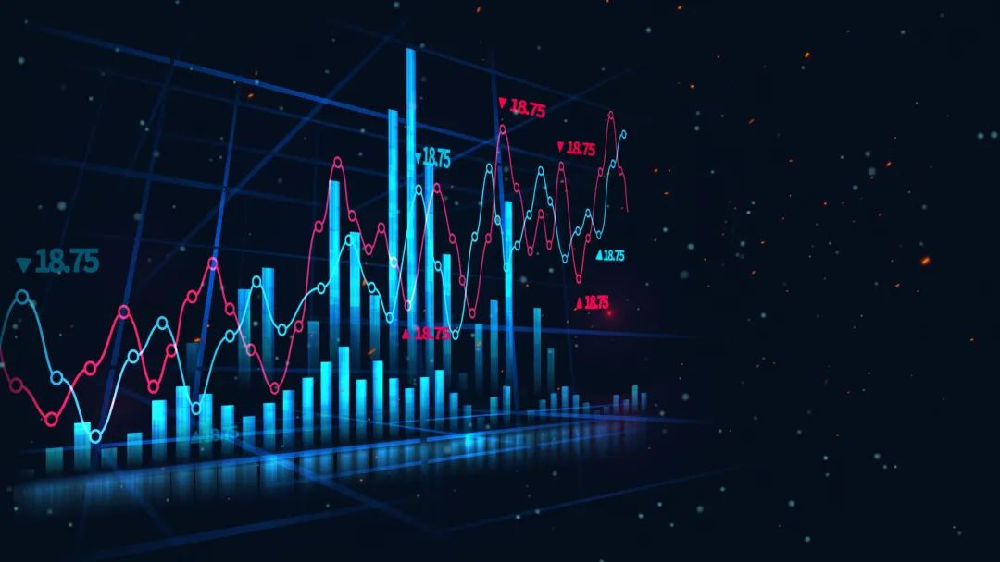
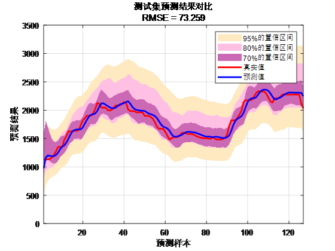
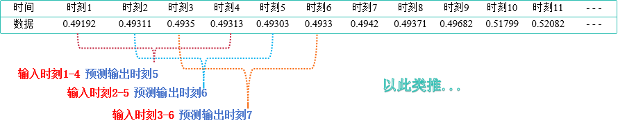
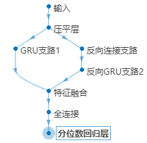
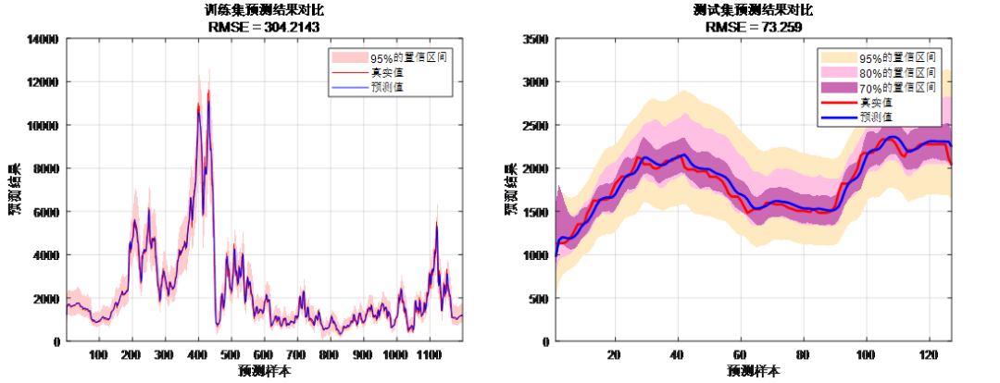
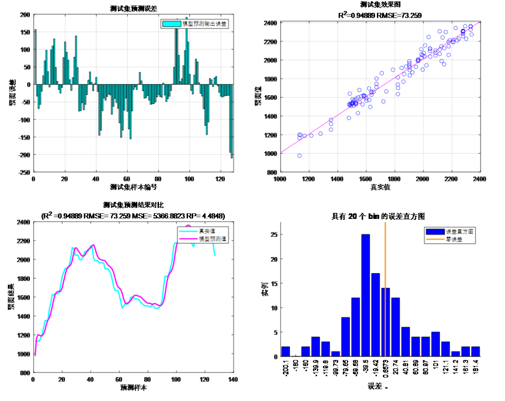
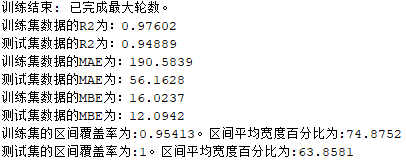

# Time series quantile interval prediction program based on QR-BiGRU, battery SOC, SOH, bearing life, load forecasting, photovoltaic, wind speed, electricity price, carbon price prediction

Applicable Platform: MATLAB 2022 and above.
Document Interpretation:
The document proposes an interval prediction method based on the QR-BiGRU neural network. The proposed method considers the bidirectional features of historical state estimation time series data, achieving more accurate time series prediction. The Quantile Regression (QR) is achieved by regressing on the percentile points of the prediction results to obtain confidence intervals for the prediction results. By integrating interval prediction, a more accurate and trustworthy interval estimation of power system line parameters is realized.
Interval Prediction Method Based on QR-BiGRU:
What is interval prediction?
A model can be used to predict the value of the dependent variable at the corresponding percentile point. Therefore, the output of each model varies according to the selected percentile point and the values of the independent variables.
Confidence interval indicator: A confidence interval tells us that under a given confidence level, the true value may fall within the range around the estimated value. For example, a 95% confidence interval: it means we have 95% confidence that the true value falls within this yellow range; an 80% confidence interval: it means we have 80% confidence that the true value falls within this light pink range, and so on. This representation helps us better understand the degree of confidence in the estimated value.
Innovations of QR-BiGRU Interval Prediction:
BiGRU: It is a type of recurrent neural network capable of capturing long-distance dependencies in sequences. Through bidirectionality, BiGRU can simultaneously consider past and future information, enhancing the model's ability to perceive dynamic changes in time series.

More comprehensive features: Interval prediction provides a range of predictions instead of a single point estimate, which can more comprehensively reflect the uncertainty and possible range of predictions.
Decision making: Interval prediction can help decision-makers make more accurate assessments, thereby formulating more effective strategies and plans.
1. Adapting to Uncertainty: In uncertain environments, interval forecasting can better cope with future changes and uncertainty, making decisions more robust.
2. Handling Outliers: Interval forecasting can better handle outliers and noise because it does not rely too heavily on a single data point but considers the entire prediction range.
3. Wide Application: Interval forecasting is not only applicable in the financial sector but can also be applied in other fields such as meteorological forecasting, supply chain management, electricity market, battery life prediction, load forecasting, photovoltaic, wind speed, electricity price, carbon price prediction, etc.
4. Data Dataset Format:
   - Data format: Predict the value at time 5 based on values at times 1-4, predict the value at time 6 based on values at times 2-5, predict the value at time 7 based on values at times 3-6, and so on.
5. Program Results: Model Structure
   - Forecast vs. Real Value Comparison:
   - Evaluation Metric Results:

## Images

<!-- PAYMENT_BLOCK -->

## Get this dataset

- Payment link (Stripe): [Buy now](https://buy.stripe.com/3cs8yP7sY87d0vu9AB)
- Payment QR code: 

<!-- /PAYMENT_BLOCK -->
